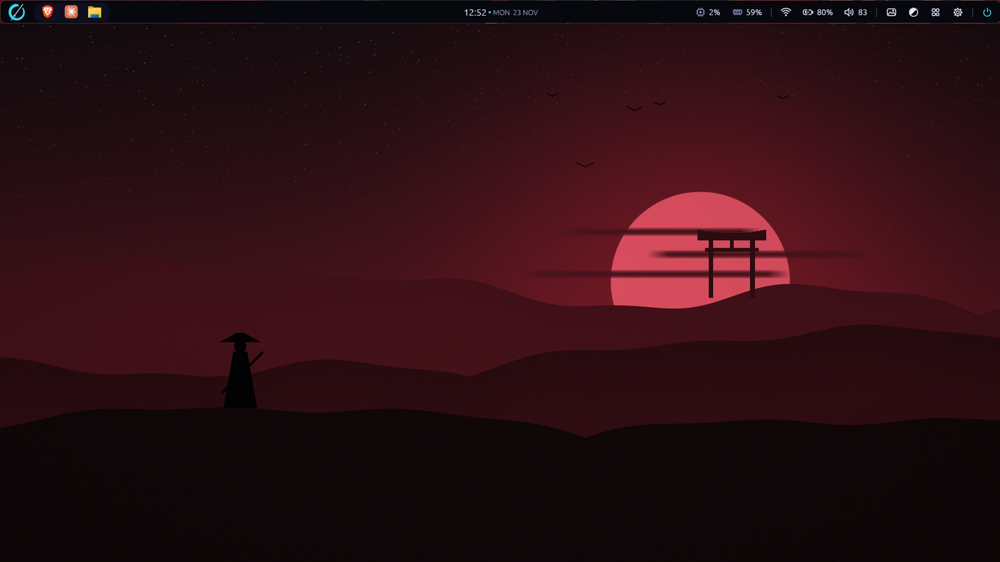

<p align="center"></p>

<h1 align="center">Ronin Bar</h1>

<p align="center"><b>A top bar for Windows 10 and 11 that replaces the taskbar.</b><br>
Apps, quick settings, a calendar, wallpapers and themes, all in one small Rust program.</p>

<p align="center">
  <a href="https://github.com/AEX0TIC/Ronin-bar/releases/latest"></a>
  <a href="https://github.com/AEX0TIC/Ronin-bar/actions/workflows/ci.yml"></a>
  
  <a href="LICENSE"></a>
</p>

<p align="center"></p>

Ronin Bar puts a slim bar across the top of the screen in place of the Windows taskbar, the way a Linux desktop does. It has its own launcher, calendar, quick settings and power menu, so day-to-day controls are one click away and look like one system rather than Windows. Maximised windows sit just below the bar, with their close, minimise and maximise buttons in view.

It's a single `.exe` with no admin rights and no extra apps to install (no GlazeWM, Zebar, Windhawk, or similar). It installs into one folder, and updates and uninstalls cleanly.

**The name.** A rōnin (浪人) is a samurai with no master. The logo is an ensō, a Zen brush circle, left open (free, bound to no lord) and cut by a katana through the gap.

---

## Contents

- [The bar](#the-bar)
- [Focus timer](#focus-timer)
- [Wi-Fi and Bluetooth](#wi-fi-and-bluetooth)
- [Quick settings](#quick-settings)
- [Always in sync with Windows](#always-in-sync-with-windows)
- [Launcher, calendar and the other popups](#launcher-calendar-and-the-other-popups)
- [Wallpapers](#wallpapers)
- [Themes](#themes)
- [Updates](#updates)
- [Requirements](#requirements)
- [Install](#install) · [Uninstall](#uninstall) · [Troubleshooting](#troubleshooting)
- [Privacy and safety](#privacy-and-safety)
- [Build from source](#build-from-source)
- [Version history](#version-history)

---

## The bar

<p align="center"></p>
<p align="center"><sub>Picture from an earlier version: since 0.5.1, part 5 is three icons (Wi-Fi, Bluetooth and quick settings) and part 8 has no Apps button.</sub></p>

| # | Part | Click | Also |
|---|---|---|---|
| 1 | **Ronin mark** | **Launcher**: every installed app with icons, search, and a **Pin** / **Unpin** button on each app | Right-click opens the Ronin panel |
| 2 | **Dock** | Pinned apps open; open windows come to the front, or minimise if already in front | Right-click a pinned app to unpin it, or an open window to pin its app. Middle-click closes a window. A line marks the window in front; dimmed means minimised |
| 3 | **Clock** | **Calendar**: today, a month view, and previous/next month | |
| 4 | **CPU · RAM** | Task Manager | Live usage |
| 5 | **Wi-Fi · Bluetooth · quick settings** | Three icons, each with its own popup: **Wi-Fi**, **Bluetooth** (see [Wi-Fi and Bluetooth](#wi-fi-and-bluetooth)) and **quick settings** | Hover Wi-Fi for the network and its signal. Wi-Fi dims when you're offline; Bluetooth dims when it's off |
| 6 | **Battery** | **Battery**: charge, time left, battery saver, brightness | A bolt while charging |
| 7 | **Sound** | **Sound**: volume slider and mute | Scroll to change the volume, right-click to mute |
| 8 | **Wallpapers · themes · settings** | Opens that page of the Ronin panel | Right-click wallpapers for the next one |
| 9 | **Power** | **Power menu**: lock, sleep, sign out, restart, shut down | Asks before anything except lock |

Each open window shows its own app's icon and name (hover to see it), even when the app runs inside another program:
- Store apps such as Settings, Calculator and Photos;
- web apps installed from Edge or Chrome, such as Netflix or YouTube Music, instead of the browser's icon.

The bar matches each window to the app Windows has it registered as. When a new version is released, an **update** arrow also appears on the bar (see [Updates](#updates)).

The bar steps aside while a fullscreen game or video is in front, and comes back after it.

## Focus timer

Click the stopwatch on the bar for a Pomodoro timer: **25 minutes of focus, then a 5-minute break**, over and over.

- Type **what you're working on** first ("Write the report"), then press **Start** or **Enter**.
- While it runs, the bar shows the task and the time left: `Write the report · 24:59`. During a break the stopwatch turns your theme's colour.
- **Pause** keeps the time you've done; **Start** carries on from there. **Reset** goes back to a fresh focus and keeps your task for the next round.

## Wi-Fi and Bluetooth

Both popups work the same way: an on/off switch at the top, your list below, and a button on each row.

| | **Wi-Fi** | **Bluetooth** |
|---|---|---|
| **Your list** | Nearby networks with signal bars, the connected one first | Your paired devices, connected ones first |
| **Buttons** | **connect** / **disconnect**; a password box for a new secured network | **connect** / **disconnect** for headphones, speakers and headsets; **forget** removes a device |
| **Adding** | Type the password once; Windows remembers the network | **search** looks for devices in pairing mode for about 25 seconds (it stops by itself, or when the popup closes), **pair** adds one (Windows asks for a PIN only if the device needs one) |
| **More** | Network settings | Bluetooth settings |

Mice, keyboards and phones connect by themselves when they're switched on, so they show their state without a connect button.

## Quick settings

Click the quick-settings icon (two switches), next to Wi-Fi and Bluetooth: 3 tiles a row, lit in your theme's colour when on. Wi-Fi and Bluetooth have their own icons and popups.

| Tile | What it does |
|---|---|
| **Airplane mode** | Every radio off; turning it off brings back the ones that were on |
| **Night light** | Warmer colours for the evening, drawn by Ronin itself, with a strength slider |
| **Mobile hotspot** | Share this PC's internet connection |
| **Accessibility** | Magnifier, on-screen keyboard, sticky keys, Narrator, Live captions |
| **Project** | PC screen only · duplicate · extend · second screen only |
| **Cast** · **Nearby sharing** | Open Windows' own screens for these (Windows has no public switch for them) |
| **Live captions** | Starts Windows Live captions (Windows 11) |
| **Power & battery** | The battery page |
| **Screen snip** | Take a screenshot of part of the screen |

Below the tiles are **brightness** and **volume** sliders, your battery, Ronin settings and the power menu.

## Always in sync with Windows

Ronin Bar doesn't keep its own copy of your settings that could drift. It follows what Windows reports, as it happens:

| What | How quickly it updates |
|---|---|
| **Wi-Fi** | The moment Windows reports a change: a scan finishing, connecting, disconnecting, signal changing, Wi-Fi switched on or off. The connected network is read directly from Windows |
| **Wi-Fi and Bluetooth switches** | Instantly. Ronin finds the radios once and keeps them, so switching never waits; switches made in Windows Settings or with the airplane key show up as soon as they happen |
| **Bluetooth devices** | The moment Windows reports a change: a device paired, connected, disconnected or removed, the same way Windows Settings is kept up to date |
| **Volume** | Five times a second, so volume keys and other apps' changes show up straight away |
| **Battery, CPU, memory** | Every second |
| **Brightness** | Every few seconds, and straight away when you move the slider |
| **Airplane mode, hotspot** | Each time quick settings opens |

When you click a switch, the popup shows the new state at once, then confirms it with Windows. If Windows is slow or doesn't answer, Ronin gives up after a few seconds and tells you, instead of freezing.

## Launcher, calendar and the other popups

Each popup opens under the item you clicked, in your theme. It closes with **Esc**, with a click anywhere else, or with another click on the same item.

- **Launcher** (Ronin mark): every app you can open, with real icons.
  - **What's listed:** software only. That means Store apps, Start-menu apps, programs and game launchers on your desktop (Steam, Epic, EA, Riot and the like), and programs that never added a Start-menu entry (found in Windows' list of installed software or their install folder).
  - **What's left out:** shortcuts to files, videos, documents and folders; uninstallers, manuals, web links, setup tools and driver helpers; Command Prompt, PowerShell and Windows' admin and developer tools.
  - **At the top:** **Pinned** (the small **×** unpins) and **Most used**, the apps you open most often.
  - **Search** matches the start of a name, any word in it, or its initials (`vsc` finds Visual Studio Code). The arrow keys choose and **Enter** opens.
  - **Each app** has a **Pin** / **Unpin** button. Right-click it to **pin**, **hide it from the launcher**, or **show it in its folder**. **show hidden** brings hidden apps back.
- **Calendar** (clock): a large clock, today's date, and a month view with today marked.
- **Sound**, **Battery** and **Power**: see [the bar](#the-bar).
- **Wi-Fi** and **Bluetooth**: see [Wi-Fi and Bluetooth](#wi-fi-and-bluetooth).
- **Wallpapers**, **Themes** and **Settings** (the picture, half-circle and gear buttons on the bar): each opens its own page. Right-clicking the Ronin mark reopens the last one.

The popups are kept ready in the background, so they open instantly and update live as Wi-Fi, volume or battery change.

## Wallpapers

- **9 Ronin originals**, drawn by Ronin Bar itself at your screen's resolution: a lone ronin, a torii gate and a setting sun, one in each theme's colours. They work offline and change along with the theme.
- **80 anime wallpapers** in 8 collections (Samurai, Anime cars, Anime scenery, Cyberpunk city, Night sky, Cherry blossom, Rainy streets, Sunset). Each collection is the 10 most-favourited of all time on [Wallhaven](https://wallhaven.cc), safe-for-work only.
- **1,363 more** in 15 categories: Anime, Summer days, Manga ink, Painted art, Nature, Flowers & blossoms, Mountains & aerial, Mist & calm, Dark & dreamy, Minimal & abstract, Monochrome, Cities & spaces, Neon & pixel, Color schemes and Mixed. They come from the community collection [dharmx/walls](https://github.com/dharmx/walls), pinned to one commit so the files can never change, and download in batches of 24 when you click **get**.

Previews load as you scroll, and a full picture downloads only when you choose it. Pick previous, next or random, or let the wallpaper change every 15 minutes to 3 hours. The pictures belong to their artists: they're downloaded to your PC for personal use and are not stored in this repository.

## Themes

<p align="center"></p>

There are 9 themes: **Ronin** (ink and crimson), **Sakura Night**, **Neon Tokyo**, **Midnight Gold**, **Ember**, **Oni Violet** and **Jade Temple**, plus two light ones, **Matcha Paper** and **Washi**. A theme colours the bar and every popup, sets Windows' dark or light mode and accent colour, and switches to its matching Ronin wallpaper.

## Updates

Ronin Bar updates itself, so you never need to download it from GitHub again.

- It checks for a new release shortly after it starts, then every 6 hours.
- When one is out, a **"New version available"** popup shows what's new, with **Install now** and **Later**. An update arrow also stays on the bar until you install.
- **Install now** downloads the new version, checks it against the release's SHA-256, puts it in place of the old one and restarts the bar. The old version is deleted. Your settings, pins and wallpapers stay.
- You can turn the popup off (**Tell me when a new version is out**), or let updates install by themselves (**Install new versions by themselves**). Both switches are in the popup and in ⚙ **Settings → Updates**, which also has **Check for updates**.

Only this repository's own release files are accepted, and only if their checksum matches.

## Requirements

| | |
|---|---|
| **Windows** | Windows 10 (version 1903 or newer) or Windows 11, 64-bit |
| **Rights** | Your normal Windows account; no administrator needed |
| **Internet** | Only for downloading wallpapers and updates. The bar, popups and Ronin wallpapers work offline |
| **Disk** | About 6 MB for the program, plus about 2 MB per downloaded wallpaper |
| **Optional hardware** | Wi-Fi adapter for the Wi-Fi popup, Bluetooth adapter for the Bluetooth popup, a laptop screen for the brightness slider (desktop monitors set their brightness on the monitor itself), a second screen for Project |
| **Windows 11 extras** | Live captions needs Windows 11 22H2 or newer; on older Windows its tile is hidden |

Nothing else needs to be installed: no runtime, no other app.

## Install

1. Download **`Ronin-Bar-<version>.exe`** from [Releases](https://github.com/AEX0TIC/Ronin-bar/releases/latest).
2. Run it. It asks once, then installs for your Windows account only, without admin rights:

```text
%LOCALAPPDATA%\Programs\Ronin Bar\
├─ ronin-bar.exe
└─ data\   settings, the wallpaper list, wallpapers\ and thumbs\
```

It also adds a Start-menu shortcut and an entry in **Settings → Apps**, and starts with Windows (you can turn that off). After this, it [updates itself](#updates).

## Uninstall

Use **Settings → Apps → Ronin Bar → Uninstall**, or ⚙ **→ Uninstall** on the bar. Uninstalling:
- brings the Windows taskbar back;
- restores the wallpaper, dark/light mode and accent colour you had before;
- turns night light off;
- removes the shortcut, the Settings → Apps entry and the startup entry;
- deletes the folder.

## Troubleshooting

| Problem | Fix |
|---|---|
| The Windows taskbar is gone after Ronin Bar was ended from Task Manager | Start Ronin Bar again and quit it from ⚙ → *Quit the bar*, or sign out and back in |
| A window's buttons are under the bar | Maximise the window again; Ronin keeps the top strip free, but a few apps place themselves |
| Bluetooth headphones won't connect | Make sure they're on and not connected to another device (a phone), then press **connect** again. Still nothing: **forget** them and **pair** them again |
| A new device isn't found | Put it in pairing mode (usually by holding its power or Bluetooth button) and press **search again** |
| "Windows did not answer in time" | Windows was busy (often just after waking from sleep). Press **refresh**, or open the popup again a few seconds later |
| The Wi-Fi icon looks offline but the internet works | Hover it: Ronin shows what Windows reports. If it says *Not connected*, open the Wi-Fi popup to have it read again |
| An app shows the wrong icon | Hover it to see its name, and [open an issue](https://github.com/AEX0TIC/Ronin-bar/issues) with that name |
| No update popup | ⚙ → Settings → Updates → **Check for updates**; check that *Tell me when a new version is out* is ticked |
| No wallpapers download | They need internet access to wallhaven.cc and github.com |

## Privacy and safety

- **No accounts or tracking.** Ronin Bar only connects to download wallpapers and to check GitHub for updates.
- **Windows' own functions only:** no scripts, no helper programs, nothing runs as administrator, and nothing outside your account is changed. The core logic has no `unsafe` code.
- **Downloads** use HTTPS only, with every address checked. Wallpapers must really be JPEG or PNG files under 25 MB. Updates must come from this repository's releases and match their published SHA-256.
- **Wi-Fi passwords** go only into Windows' own saved profile for that network.
- **The Windows taskbar is only hidden, never changed.** It comes back when you quit, uninstall, untick ⚙ → *Replace the Windows taskbar*, or if Ronin Bar ever crashes.

## Build from source

You need Rust 1.87 or newer, on Windows:

```powershell
cargo test --workspace
cargo build --release -p ronin-bar   # target\release\ronin-bar.exe
```

| Folder | What's inside |
|---|---|
| `crates/core` | Themes, settings, the drawn wallpapers, night light, the calendar, Wi-Fi and Bluetooth rules, pins, the wallpaper catalogue and update checks. Tested on any OS, with no `unsafe` code |
| `crates/app` | The Windows program: the bar, popups, dock, Wi-Fi (`net.rs`), Bluetooth (`bt.rs`), quick settings, downloads, the updater and the installer |

**Publishing a release:** raise `version` in `Cargo.toml`, merge to `main`, then run **Actions → release**. Installed copies pick it up through the [updater](#updates).

## Version history

| Version | What changed |
|---|---|
| **0.8.1** | Wallpapers download and change at once: no waiting before a clicked picture, 4 at a time for categories, and the bar never pauses while the wallpaper is applied |
| **0.8.0** | Focus timer: a Pomodoro on the bar (25 min focus, 5 min break) with Start, Pause and Reset, and the task you're working on shown next to the time |
| **0.7.3** | Wallpapers, Themes and Settings each open as their own page from their bar button; Settings shows only settings |
| **0.7.2** | The bar follows the screen's real scale: proper height and width after a scale or monitor change, and the panel and popups open in the right place |
| **0.7.1** | The launcher lists only software: programs and game launchers from your desktop are added (not files, videos or documents), apps like DaVinci Resolve are found through their install folder, Command Prompt, PowerShell and Windows' admin tools are gone, and so is the power button |
| **0.7.0** | A cleaner, easier launcher: only real apps (helpers, links and manuals left out), programs without a Start-menu entry added, Most used, smarter search with initials, arrow keys, and a right-click menu to pin, hide or show in folder |
| **0.6.2** | Bluetooth without lag: Windows reports each device change instead of Ronin asking again and again; search stops by itself and never shows while Bluetooth is off; Wi-Fi and Bluetooth switches react instantly; the launcher is just apps and power |
| **0.6.1** | Wi-Fi, Bluetooth and quick settings never freeze (slow Windows calls get a time limit); everything follows Windows live: change reports, radio switches, volume keys |
| **0.6.0** | Bluetooth popup works like Wi-Fi: connect / disconnect, search, pair, forget |
| **0.5.1** | Separate Wi-Fi, Bluetooth and quick-settings icons; **Pin** / **Unpin** in the launcher; a simpler Ronin panel; web apps like Netflix show their own icon |
| **0.5.0** | In-app updates with a "New version available" popup; a new README |
| **0.4.0** | Ronin's own popups instead of Windows' flyouts: launcher, calendar, sound, battery with brightness, Wi-Fi, power, quick settings; real icons for Store apps; faster popups |
| **0.3.0** | Wallpaper previews fixed; 1,363 more wallpapers in 15 categories; 4 new themes (9 in all) |
| **0.2.0** | The bar moves to the top and replaces the taskbar, with windows below it like a Linux desktop; the Ronin logo; every setting on the bar; Quit and Uninstall fixed |
| **0.1.0** | First release: the dock, wallpapers and themes |

Every release, with its download and SHA-256, is on the [Releases](https://github.com/AEX0TIC/Ronin-bar/releases) page.

## Licence

[MIT](LICENSE) © AEX0TIC. Wallpapers belong to their artists.
