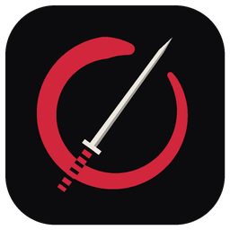

<p align="center"></p>

# Ronin Bar

A smart dock for the top of the Windows 10/11 screen that replaces the Windows taskbar: your pinned apps and open windows with their real icons, working system controls, wallpapers and five themes. One small program written in Rust: no GlazeWM, Zebar, Windhawk, Oh My Posh or any other app to install.

**The mark.** A rōnin (浪人) is a samurai with no master. The logo is an ensō, a single Zen brush circle, left open (free, bound to no lord) and cut by a katana through the gap.

## What it does

The dock sits at the top of the screen and takes the Windows taskbar's place (turn that off in ⚙ if you want both). Windows keeps the top strip free, so maximised windows and their close / minimise / maximise buttons stay below it. It steps aside while a fullscreen game or video is in front.

**Left: Start and the dock**

| | |
|---|---|
| Ronin mark | Opens the Start menu. Right-click: Ronin's panel |
| pinned apps | Click to open. Right-click to manage them. Pick them from your Start menu with ▦ (up to 16) |
| open windows | Click to bring a window to the front, click the one in front to minimise it, middle-click to close it, right-click to pin its program. A bar under the icon marks the window in front; dimmed icons are minimised |

**Middle:** time and date. Click: notifications and calendar.

**Right: controls**, every one a single click

| | |
|---|---|
| cpu, ram | Processor and memory use. Click: Task Manager |
| network, battery | Online or not; charge (bolt while charging). Click: Windows quick settings (Wi-Fi, Bluetooth, brightness) |
| speaker | Click to mute, scroll to change the volume, right-click for the sound panel |
| picture | Wallpapers. Right-click: next wallpaper |
| half circle | Themes |
| ▦ | Apps: search the Start menu, pin, unpin, reorder |
| ⚙ | Settings: replace the taskbar, start with Windows, quit, uninstall |
| power | Lock, sleep, restart, shut down (asks before sleep, restart and shut down) |

**9 Ronin originals**, drawn by Ronin Bar itself at your screen's resolution: a sunset over misty mountains with stars, clouds across the sun, a torii gate, birds and a lone ronin (cherry petals in Sakura and Washi), one in each theme's colours. They are ready on first start, work offline, and follow the theme.

**80 anime wallpapers** in 8 collections: Samurai, Anime cars, Anime scenery, Cyberpunk city, Night sky, Cherry blossom, Rainy streets and Sunset, each the 10 most-favourited of all time on [Wallhaven](https://wallhaven.cc). Previews arrive in the background on first start; a full picture is downloaded when you choose it. They are not stored in this repository, because they belong to their artists. Only the anime category and safe-for-work images are used. Previous / next / random, or change automatically every 15 min to 3 h.

**1,363 more from GitHub**: the whole [dharmx/walls](https://github.com/dharmx/walls) community collection (logos, icon sets, patterns and pictures too small for a screen left out), sorted into 15 categories: Anime, Summer days, Manga ink, Painted art, Nature, Flowers & blossoms, Mountains & aerial, Mist & calm, Dark & dreamy, Minimal & abstract, Monochrome, Cities & spaces, Neon & pixel, Color schemes (Nord, Gruvbox, Solarized) and Mixed. A category downloads in batches of 24 when you click **get** (about 2 MB a picture), from files pinned to one commit so they can never change. They belong to their artists and are downloaded for personal use only; thanks to the collection's curators.

**9 themes**: Ronin (ink and crimson), Sakura Night, Neon Tokyo, Midnight Gold, Ember, Oni Violet, Jade Temple, and two light ones, Matcha Paper and Washi. Each colours the dock and sets Windows' dark/light mode and accent colour.

## Install

Download `Ronin-Bar-<version>.exe` from [Releases](https://github.com/AEX0TIC/Ronin-bar/releases) and run it. It asks once, then installs itself for your Windows account only (no admin needed):

```text
%LOCALAPPDATA%\Programs\Ronin Bar\
├─ ronin-bar.exe
└─ data\   settings, the wallpaper list, wallpapers\ and thumbs\
```

It also adds a Start-menu shortcut, an entry in **Settings → Apps**, and (if you leave it on) starts with Windows.

## Uninstall

**Settings → Apps → Ronin Bar → Uninstall**, or ⚙ **→ Uninstall** on the dock. It brings the Windows taskbar back, puts back the wallpaper, dark/light mode and accent colour you had before, removes the shortcut, the Settings → Apps entry and the startup entry, and deletes the folder.

## Safety

- Only Windows' own functions are used; no scripts and no helper programs. The core logic has no `unsafe` code.
- Downloads use HTTPS only, from `wallhaven.cc`, with every URL and id checked; each file must really be a JPEG or PNG under 25 MB.
- Nothing runs as administrator, and nothing outside your account is changed.
- The Windows taskbar is only hidden, never changed: it comes back when you quit, uninstall, untick ⚙ → Replace the Windows taskbar, or if Ronin Bar ever crashes. If Ronin Bar is killed from Task Manager, start it again and quit it, or sign out and in.

The wallpapers belong to their artists. Ronin Bar downloads them to your PC for personal use and does not redistribute them; hover a wallpaper to see its page on wallhaven.cc.

## Build

Requires Rust 1.87+ on Windows.

```powershell
cargo test --workspace
cargo build --release -p ronin-bar   # target\release\ronin-bar.exe
```

`crates/core` (themes, settings, dock pins, wallpaper catalogue and checks) is tested on any OS; `crates/app` is the Windows program.
