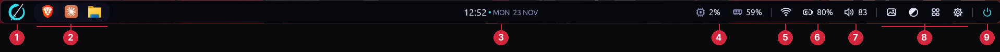
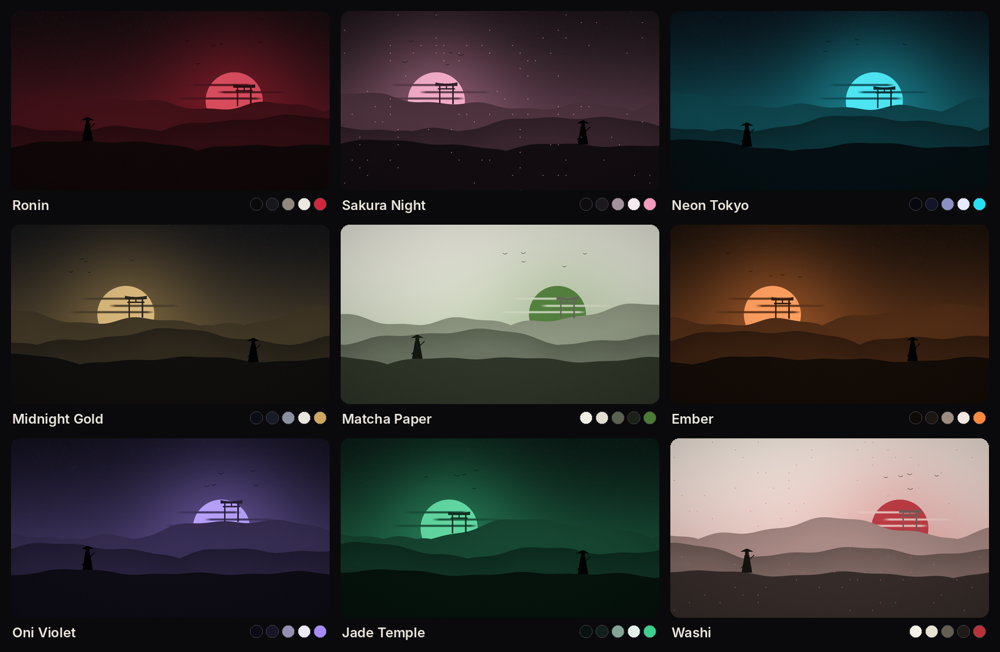

<p align="center"></p>

<h1 align="center">Ronin Bar</h1>

<p align="center"><b>A top bar for Windows 10 and 11 that replaces the taskbar.</b><br>
Apps, quick settings, a calendar, wallpapers and themes, all in one small Rust program.</p>

<p align="center">
  <a href="https://github.com/AEX0TIC/Ronin-bar/releases/latest"></a>
  <a href="https://github.com/AEX0TIC/Ronin-bar/actions/workflows/ci.yml"></a>
  
  <a href="LICENSE"></a>
</p>

<p align="center"></p>

Ronin Bar puts a slim bar across the top of the screen in place of the Windows taskbar, the way a Linux desktop does. It has its own launcher, calendar, quick settings and power menu, so day-to-day controls are one click away and look like one system rather than Windows. Maximised windows sit just below the bar, with their close, minimise and maximise buttons in view.

It's a single `.exe` with no admin rights and no extra apps to install (no GlazeWM, Zebar, Windhawk, or similar). It installs into one folder, and updates and uninstalls cleanly.

**The name.** A rōnin (浪人) is a samurai with no master. The logo is an ensō, a Zen brush circle, left open (free, bound to no lord) and cut by a katana through the gap.

---

## Contents

- [The bar](#the-bar)
- [Quick settings](#quick-settings)
- [Launcher, calendar and the other popups](#launcher-calendar-and-the-other-popups)
- [Wallpapers](#wallpapers)
- [Themes](#themes)
- [Updates](#updates)
- [Install](#install) · [Uninstall](#uninstall)
- [Privacy and safety](#privacy-and-safety)
- [Build from source](#build-from-source)

---

## The bar

<p align="center"></p>

| # | Part | Click | Also |
|---|---|---|---|
| 1 | **Ronin mark** | **Launcher**: every installed app with icons, search, and a **Pin** / **Unpin** button on each app | Right-click opens the Ronin panel |
| 2 | **Dock** | Pinned apps open; open windows come to the front, or minimise if already in front | Right-click a pinned app to unpin it, or an open window to pin its app. Middle-click closes a window. A line marks the window in front; dimmed means minimised |
| 3 | **Clock** | **Calendar**: today, a month view, and previous/next month | |
| 4 | **CPU · RAM** | Task Manager | Live usage |
| 5 | **Wi-Fi · Bluetooth · quick settings** | Three icons: **Wi-Fi** (networks: connect, disconnect, join with a password), **Bluetooth** (on/off and your paired devices, connected first) and **quick settings** (below) | Wi-Fi dims when you're offline; Bluetooth dims when it's off |
| 6 | **Battery** | **Battery**: charge, time left, battery saver, brightness | A bolt while charging |
| 7 | **Sound** | **Sound**: volume slider and mute | Scroll to change the volume, right-click to mute |
| 8 | **Wallpapers · themes · settings** | Opens that page of the Ronin panel | Right-click wallpapers for the next one |
| 9 | **Power** | **Power menu**: lock, sleep, sign out, restart, shut down | Asks before anything except lock |

Each open window shows its own app icon. That includes Store apps such as Settings, Calculator and Photos, which the bar looks up by their app ID. When a new version is released, an **update** arrow also appears on the bar (see [Updates](#updates)).

The bar steps aside while a fullscreen game or video is in front, and comes back after it.

## Quick settings

Click the quick-settings icon (two switches), next to Wi-Fi and Bluetooth: 3 tiles a row, lit in your theme's colour when on. Wi-Fi and Bluetooth have their own icons and popups.

| Tile | What it does |
|---|---|
| **Airplane mode** | Every radio off; turning it off brings back the ones that were on |
| **Night light** | Warmer colours for the evening, drawn by Ronin itself, with a strength slider |
| **Mobile hotspot** | Share this PC's internet connection |
| **Accessibility** | Magnifier, on-screen keyboard, sticky keys, Narrator, Live captions |
| **Project** | PC screen only · duplicate · extend · second screen only |
| **Cast** · **Nearby sharing** | Open Windows' own screens for these (Windows has no public switch for them) |
| **Live captions** | Starts Windows Live captions (Windows 11) |
| **Power & battery** | The battery page |
| **Screen snip** | Take a screenshot of part of the screen |

Below the tiles are **brightness** and **volume** sliders, your battery, Ronin settings and the power menu.

## Launcher, calendar and the other popups

Each popup opens under the item you clicked, in your theme. It closes with **Esc**, with a click anywhere else, or with another click on the same item.

- **Launcher** (Ronin mark): every installed app, Store apps included, with real icons. Type to search; **Enter** opens the first match. Each app has a **Pin** button (**Unpin** once pinned). Pinned apps sit at the top, where the small **×** unpins them.
- **Calendar** (clock): a large clock, today's date, and a month view with today marked.
- **Sound**, **Battery** and **Power**: see [the bar](#the-bar).
- **Wi-Fi** and **Bluetooth**: networks, and paired devices with their connection state.
- **Ronin panel** (right-click the mark, or the buttons at the right of the bar): wallpapers, themes and settings.

The popups are kept ready in the background, so they open instantly and update live as Wi-Fi, volume or battery change.

## Wallpapers

- **9 Ronin originals**, drawn by Ronin Bar itself at your screen's resolution: a lone ronin, a torii gate and a setting sun, one in each theme's colours. They work offline and change along with the theme.
- **80 anime wallpapers** in 8 collections (Samurai, Anime cars, Anime scenery, Cyberpunk city, Night sky, Cherry blossom, Rainy streets, Sunset). Each collection is the 10 most-favourited of all time on [Wallhaven](https://wallhaven.cc), safe-for-work only.
- **1,363 more** in 15 categories: Anime, Summer days, Manga ink, Painted art, Nature, Flowers & blossoms, Mountains & aerial, Mist & calm, Dark & dreamy, Minimal & abstract, Monochrome, Cities & spaces, Neon & pixel, Color schemes and Mixed. They come from the community collection [dharmx/walls](https://github.com/dharmx/walls), pinned to one commit so the files can never change, and download in batches of 24 when you click **get**.

Previews load as you scroll, and a full picture downloads only when you choose it. Pick previous, next or random, or let the wallpaper change every 15 minutes to 3 hours. The pictures belong to their artists: they're downloaded to your PC for personal use and are not stored in this repository.

## Themes

<p align="center"></p>

There are 9 themes: **Ronin** (ink and crimson), **Sakura Night**, **Neon Tokyo**, **Midnight Gold**, **Ember**, **Oni Violet** and **Jade Temple**, plus two light ones, **Matcha Paper** and **Washi**. A theme colours the bar and every popup, sets Windows' dark or light mode and accent colour, and switches to its matching Ronin wallpaper.

## Updates

Ronin Bar updates itself, so you never need to download it from GitHub again.

- It checks for a new release shortly after it starts, then every 6 hours.
- When one is out, a **"New version available"** popup shows what's new, with **Install now** and **Later**. An update arrow also stays on the bar until you install.
- **Install now** downloads the new version, checks it against the release's SHA-256, puts it in place of the old one and restarts the bar. The old version is deleted. Your settings, pins and wallpapers stay.
- You can turn the popup off (**Tell me when a new version is out**), or let updates install by themselves (**Install new versions by themselves**). Both switches are in the popup and in ⚙ **Settings → Updates**, which also has **Check for updates**.

Only this repository's own release files are accepted, and only if their checksum matches.

## Install

1. Download **`Ronin-Bar-<version>.exe`** from [Releases](https://github.com/AEX0TIC/Ronin-bar/releases/latest).
2. Run it. It asks once, then installs for your Windows account only, without admin rights:

```text
%LOCALAPPDATA%\Programs\Ronin Bar\
├─ ronin-bar.exe
└─ data\   settings, the wallpaper list, wallpapers\ and thumbs\
```

It also adds a Start-menu shortcut and an entry in **Settings → Apps**, and starts with Windows (you can turn that off). After this, it [updates itself](#updates).

## Uninstall

Use **Settings → Apps → Ronin Bar → Uninstall**, or ⚙ **→ Uninstall** on the bar. Uninstalling:
- brings the Windows taskbar back;
- restores the wallpaper, dark/light mode and accent colour you had before;
- turns night light off;
- removes the shortcut, the Settings → Apps entry and the startup entry;
- deletes the folder.

## Privacy and safety

- **No accounts or tracking.** Ronin Bar only connects to download wallpapers and to check GitHub for updates.
- **Windows' own functions only:** no scripts, no helper programs, nothing runs as administrator, and nothing outside your account is changed. The core logic has no `unsafe` code.
- **Downloads** use HTTPS only, with every address checked. Wallpapers must really be JPEG or PNG files under 25 MB. Updates must come from this repository's releases and match their published SHA-256.
- **Wi-Fi passwords** go only into Windows' own saved profile for that network.
- **The Windows taskbar is only hidden, never changed.** It comes back when you quit, uninstall, untick ⚙ → *Replace the Windows taskbar*, or if Ronin Bar ever crashes.

## Build from source

You need Rust 1.87 or newer, on Windows:

```powershell
cargo test --workspace
cargo build --release -p ronin-bar   # target\release\ronin-bar.exe
```

| Folder | What's inside |
|---|---|
| `crates/core` | Themes, settings, the drawn wallpapers, night light, the calendar, Wi-Fi rules, pins, the wallpaper catalogue and update checks. Tested on any OS, with no `unsafe` code |
| `crates/app` | The Windows program: the bar, popups, dock, quick settings, downloads, the updater and the installer |

**Publishing a release:** raise `version` in `Cargo.toml`, merge to `main`, then run **Actions → release**. Installed copies pick it up through the [updater](#updates).

## Licence

[MIT](LICENSE) © AEX0TIC. Wallpapers belong to their artists.
